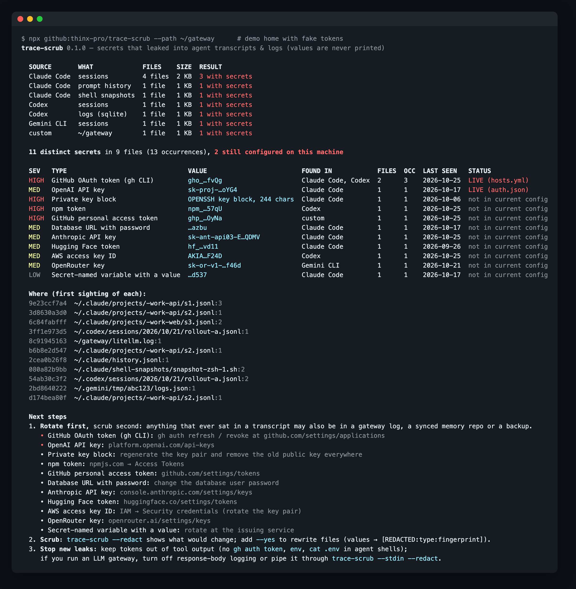

# trace-scrub

**Find the API keys and tokens that leaked into your AI agent transcripts, gateway logs and memory folders, then redact them in place.**
Offline, zero dependencies, values are never printed.

<!-- agent-preflight -->
> **Also a Claude Code skill.** `trace-scrub` is part of [agent-preflight](https://github.com/thinx-pro/agent-preflight), 16 offline checks for coding agents: `/plugin marketplace add thinx-pro/agent-preflight` then `/plugin install trace-scrub@agent-preflight`, and ask Claude in plain words.

   



## Why

Agent CLIs keep a full record of every session on disk: every tool output, every pasted `.env`, every `gh auth status -t`. Gateways that log full request/response bodies keep a second copy. Those files are rarely treated as sensitive.

- **LiteLLM 1.107.0 (21 Oct 2026).** The [official incident report](https://docs.litellm.ai/blog/security-incident-oct-21-2026) says the attacker held three sets of developer GitHub CLI credentials. LiteLLM observed "specific situations in which Claude Code will embed a user's GitHub CLI OAuth token into a response body", and believes the attacker read those tokens from the logs of an internal, internet-exposed LiteLLM deployment. The investigation was still in progress when this was written.
- The same thing happens locally without any gateway: an agent runs `gh auth status -t`, `env` or `cat .env`, and the output is saved verbatim in the session file.
- Secret scanners such as gitleaks and trufflehog are built for repositories. They don't know where Claude Code, Codex or Gemini CLI keep sessions, and they don't tell you which leaked token is *still the one you are logged in with*.

Most tools that keep secrets out of the agent's context do so *from now on*. trace-scrub deals with what is already sitting in your history.

## Quick start

```bash
npx github:thinx-pro/trace-scrub                 # scan the default agent locations (read-only)
npx github:thinx-pro/trace-scrub --redact        # dry run: which files would be rewritten
npx github:thinx-pro/trace-scrub --redact --yes  # rewrite: secret → [REDACTED:<type>:<fingerprint>]
```

**Rotate first, scrub second.** Redaction cleans this machine's copies. A token that sat in a transcript may also be in a gateway log, a synced memory repo or a backup.

## What it scans

| Agent | Locations (default) |
|---|---|
| Claude Code | `~/.claude/projects/**.jsonl`, `history.jsonl`, `paste-cache`, `file-history`, `shell-snapshots`, `debug`, `plans` |
| Codex | `~/.codex/sessions`, `archived_sessions`, `history.jsonl`, `memories`, `shell_snapshots`, `*.sqlite` logs (scan only) |
| Gemini CLI | `~/.gemini/tmp`, `~/.gemini/history` |
| OpenCode | `~/.local/share/opencode/storage`, `log` |
| Cline / Roo Code | VS Code / Cursor `globalStorage/.../tasks` |
| Aider | `~/.aider.chat.history.md`, `~/.aider.input.history` |
| Anything else | `--path <dir|file>` (gateway logs, memory folders, DB dumps), repeatable; `--only` skips the defaults |

Credential files such as `~/.codex/auth.json` and `gh/hosts.yml` are **not** reported, because holding the current credential is their job. They are only fingerprinted, so that a leaked token which is still configured gets marked **LIVE** and sorted to the top.

## What it detects

GitHub (`gho_` gh CLI OAuth, `ghp_`, fine-grained `github_pat_`, app tokens), GitLab, npm, PyPI, AWS access key IDs, Google OAuth access tokens, private key blocks, Anthropic (API, admin, Claude subscription OAuth), OpenAI (project, service-account, admin, legacy), OpenRouter, Google AI Studio / Gemini, Groq, xAI, Hugging Face, Linear, Replicate, Perplexity, Stripe live keys, Slack, database URLs with a password, and a generic rule for `*_API_KEY= / *_SECRET= / *_TOKEN= / *PASSWORD=` assignments. The generic rule needs a random-looking value and skips code such as `org.API_KEY` or `signingSecret`.

The patterns understand JSON-escaped transcripts: a token right after `\n` inside a JSONL string is still found.

## More usage

```bash
trace-scrub --since 7                          # only files touched in the last week
trace-scrub --path ~/litellm-logs --only       # just your gateway logs
trace-scrub --json > findings.json             # fingerprints, masked values, files, live status
trace-scrub --md                               # Markdown table for an incident ticket
psql -c "copy (select response from \"LiteLLM_SpendLogs\") to stdout" mydb | trace-scrub --stdin
cat gateway.log | trace-scrub --stdin --redact > gateway.clean.log   # filter mode
```

Exit codes: `0` nothing found, `1` secrets found, `2` usage error. You can use it as a gate.

## How it works

1. Walks the known transcript, log and memory locations for each agent CLI (and your `--path`s). Binary files are skipped. SQLite files are read as raw bytes, since SQLite stores text uncompressed.
2. Matches each file against format-specific patterns, then drops placeholders (`sk-your-key-here`, `xxxx`, `abcdefgh…`, `${VAR}`), identifiers and low-entropy values.
3. Groups hits by **fingerprint** (first 10 hex chars of SHA-256). The same token copied into 40 sessions shows as one row, with counts, agents, files and first/last seen.
4. Fingerprints the credentials currently in `gh/hosts.yml`, `~/.codex/auth.json`, `~/.claude/.credentials.json`, `.npmrc`, `.aws/credentials`, shell rc files, your environment and `gh auth token` (gh keeps its token in the keychain on macOS), then marks matches **LIVE**. Nothing is sent anywhere.
5. `--redact --yes` rewrites each file atomically (temp file + rename, same permissions). The redaction keeps JSONL valid and keeps the fingerprint, so you can still tell which token was where. Files modified in the last 10 minutes (live sessions) are skipped unless you pass `--include-active`. If a file changes mid-rewrite, it is left alone.

## Limits and roadmap

- Pattern-based: it finds known formats and secret-named assignments. A bare random password in prose won't be found. Expect some false positives from the generic rule. Check the `LOW` rows before you act on them.
- It does not check whether a token is still valid with the provider. Doing so would mean sending your tokens over the network.
- SQLite databases (e.g. Codex logs) are scanned but never rewritten. Delete them through the app or remove the files.
- Cursor's own chat history (SQLite `state.vscdb`) is not covered yet. Use `--path` to point at it for a scan-only pass.
- Roadmap: a write-time redaction callback for LiteLLM and other gateways, a Claude Code `Stop` hook that scrubs the session that just ended, Windows paths, and memory-tool layouts (ai-memory, mem0 exports).

## Tests

```bash
npm test
```

The tests build a fake home with format-valid random tokens (generated at runtime, never committed). They check detection, LIVE marking, dry run vs rewrite, JSONL validity after redaction, active-file skipping, `--since`, `--stdin` filtering and the false-positive filters.

It was also run read-only on one real developer machine (about 2,200 Claude Code and Codex session files, 4.4 GB). It found real keys there, mostly `.env` files that an agent had `cat`-ed or `grep`-ed. The generic `LOW` hits were reviewed by variable name and value shape (never by value). The ones checked were real secret values, not code, but that is one machine and not a measured false-positive rate.

## License

MIT. If it found something on your machine, a ⭐ helps others find it.
